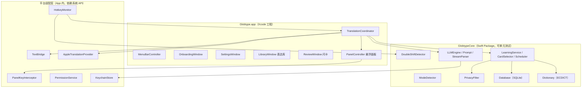
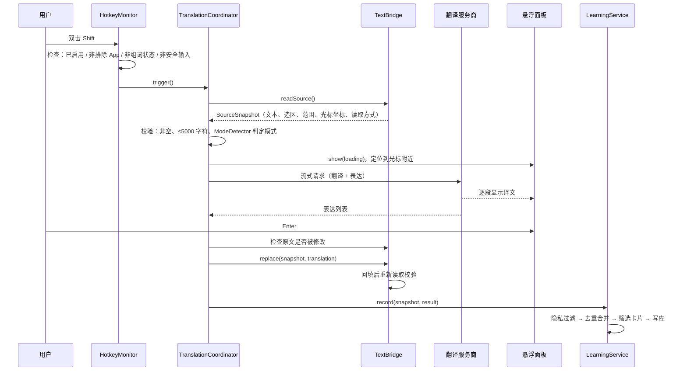
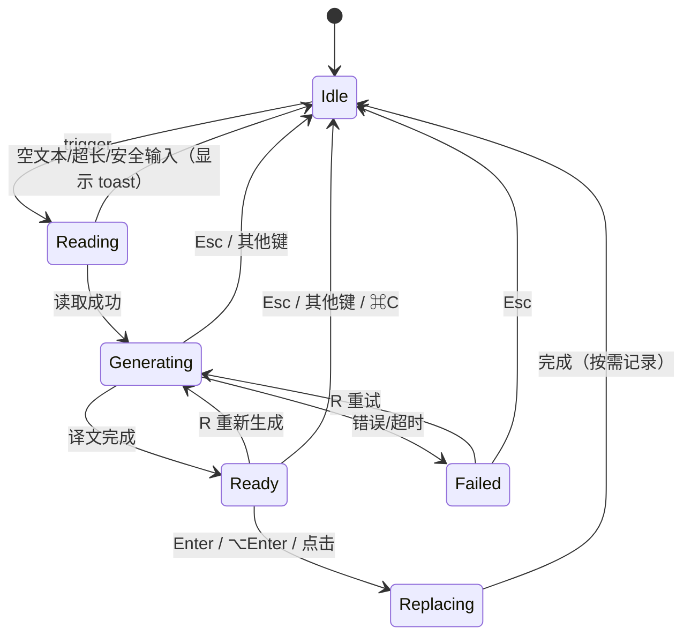
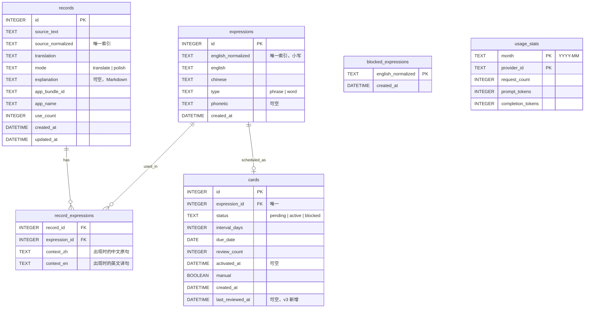

# 设计文档：Globtype MVP

## 概述

Globtype 是一个原生 macOS 菜单栏应用（Swift + SwiftUI + AppKit），最低支持 macOS 15。它通过 `CGEventTap` 监听全局按键，识别双击 Shift；通过辅助功能接口（`AXUIElement`）读取和回填其他 App 输入框的文本，失败时退回剪贴板方案；通过用户自配的大模型服务商或 Apple 翻译框架完成中译英或英文润色。被接受的翻译写入本地 SQLite，从中提取值得学习的表达，按简化 SM-2 算法安排复习。

设计原则：
- **不抢焦点**：悬浮面板永不成为 key window，按键通过事件监听拦截，目标输入框的光标和选区保持不变
- **层层降级**：取词、回填、光标定位、翻译服务商都有兜底路径
- **核心逻辑可测试**：与系统 API 无关的逻辑放在独立的 Swift Package 中，用 `swift test` 运行单元测试
- **数据不出本机**：除发送给用户所选服务商的源文本外，没有任何网络请求

## 架构

### 分层



### 一次翻译的完整流程



## 组件与接口

### 1. HotkeyMonitor（需求 1、2）

**实现方式**：创建一个 `kCGEventTapOptionDefault`（可修改事件）的会话级 `CGEventTap`，监听 `flagsChanged`、`keyDown`、`leftMouseDown`、`rightMouseDown`。

- 可修改事件的 tap 需要辅助功能权限；监听键盘事件还可能需要输入监控权限，两者都由 `PermissionService` 检查
- 回调中只做状态更新和派发，重活异步到主队列，避免 tap 因超时被系统停用
- 收到 `kCGEventTapDisabledByTimeout` / `ByUserInput` 时立即重新启用

**双击判定**交给 Core 中的纯状态机 `DoubleShiftDetector`：

```swift
public enum KeyInput {
    case shiftDown(timestamp: TimeInterval)
    case shiftUp(timestamp: TimeInterval)
    case otherKey          // 任意非 Shift 按键或修饰键
}

public struct DoubleShiftDetector {
    public var threshold: TimeInterval = 0.4
    public mutating func feed(_ input: KeyInput) -> Bool  // 返回 true 表示触发
}
```

判定规则：
- 一次"单击"= Shift 按下后在没有其他按键的情况下松开
- 第二次单击的松开时刻距第一次单击的按下时刻 ≤ 400ms 时触发
- 期间出现 `otherKey`（包括按住 Shift 输入大写字母）则状态重置
- 左右 Shift 均可，左右混按也算

**触发前检查**（按顺序，任一不满足即忽略）：
1. 用户已启用 Globtype
2. 前台 App 的 bundle ID 不在排除列表（默认含 `com.jetbrains.*`）
3. `IsSecureEventInputEnabled()` 为假
4. 不处于输入法组词状态（见下）
5. 焦点元素的 `kAXSubroleAttribute` 不是 `AXSecureTextField`（在 TextBridge 读取时再次确认）

**组词状态检测**：macOS 没有跨 App 的公开接口能查询 marked text。采用启发式判断：在第一次 Shift 按下的瞬间，用 `CGWindowListCopyWindowInfo` 检查当前输入法进程（通过 `TISCopyCurrentKeyboardInputSource` 取得 bundle ID）是否有可见的候选窗。有则记为组词状态，本次双击不触发。

**中英模式恢复（需求 1.4）**：中文输入法用 Shift 切换中英时，双击 Shift 会连切两次，净效果通常是回到原模式，因此多数情况下不需要额外处理。系统没有公开接口读取输入法内部的中英模式，所以无法在"没有回到原模式"时主动纠正。M0 阶段需要在系统拼音、搜狗、微信输入法上实测；如果有输入法做不到净效果不变，引导该输入法的用户改用自定义快捷键。

**自定义快捷键**：设置页的录制控件记录键码与修饰键（必须含 ⌘ / ⌥ / ⌃ 之一），由同一个 event tap 在 keyDown 时匹配并吞掉，与双击 Shift 并存。

### 2. TextBridge（需求 3、6）

```swift
struct SourceSnapshot {
    let appBundleID: String
    let appName: String
    let element: AXUIElement?          // 剪贴板方式时为 nil
    let fullText: String?              // AX 方式可得
    let selectedRange: NSRange?        // UTF-16 单位
    let sourceText: String             // 实际要翻译的文本
    let scope: Scope                   // .selection / .fullText
    let method: ReadMethod             // .accessibility / .clipboard
    let caretRect: CGRect?             // 屏幕坐标
    let elementRect: CGRect?
}

protocol TextBridge {
    func readSource() async throws -> SourceSnapshot
    func hasChanged(since snapshot: SourceSnapshot) async -> Bool
    func replace(_ snapshot: SourceSnapshot, with text: String) async throws -> ReplaceResult
}

enum ReplaceResult { case verified, unverified, fallbackCopied }
```

**读取**（按优先级）：
1. `AXUIElementCreateSystemWide` → `kAXFocusedUIElementAttribute` 取焦点元素
2. 若子角色为 `AXSecureTextField`，抛出 `.secureField`
3. 读 `kAXSelectedTextRangeAttribute`、`kAXSelectedTextAttribute`、`kAXValueAttribute`
4. 若取不到焦点元素或值为空，并且目标 App 是 Electron/Chromium（通过 bundle 内是否含 `Electron Framework.framework` 或 bundle ID 列表判断），对该 App 的 `AXUIElementCreateApplication(pid)` 设置 `AXManualAccessibility = true`（Chrome 用 `AXEnhancedUserInterface`），等待 100ms 后重试一次
5. 仍失败则走剪贴板方式：备份剪贴板 → 模拟 ⌘C → 如果剪贴板未变化（说明无选区），模拟 ⌘A 后再 ⌘C → 读取 → 恢复剪贴板
6. 光标坐标：`kAXBoundsForRangeParameterizedAttribute` 查询选区范围的边界；失败则用 `kAXPositionAttribute` + `kAXSizeAttribute` 取元素矩形；再失败由面板使用鼠标位置

所有 AX 调用通过 `AXUIElementSetMessagingTimeout` 设置 0.5 秒超时，并在后台队列执行，避免目标 App 卡死时拖住 Globtype。

**范围单位**：AX 的 `CFRange` 以 UTF-16 编码单元计数，全程用 `NSString` 长度计算，避免 emoji、中文等多字节字符导致错位。

**回填**：
1. AX 方式：若 `scope == .fullText`，先把 `kAXSelectedTextRangeAttribute` 设为 `{0, fullText.utf16.count}`；然后写入 `kAXSelectedTextAttribute = translation`。这样等同于用户输入替换选区，多数 App 能用 ⌘Z 撤销
2. 写入失败或 App 不支持时：剪贴板方式，备份剪贴板 → 写入译文 → 模拟 ⌘V → 延迟 300ms 恢复剪贴板
3. 校验：重新读取 `kAXValueAttribute`，检查其中包含译文（译文较长时比对前 50 个字符）。剪贴板方式无法校验时返回 `.unverified`，不打扰用户
4. 校验明确失败时：译文放入剪贴板（不恢复原剪贴板），返回 `.fallbackCopied`，由面板提示

**原文变化检测（需求 6.7）**：回填前对 AX 方式重新读取 `kAXValueAttribute` 与快照比较；剪贴板方式无法低成本检测，跳过此检查。

**剪贴板操作**的共同细节：
- 备份时保存所有 `NSPasteboardItem` 的全部类型数据
- 临时写入时附加 `org.nspasteboard.TransientType` 和 `org.nspasteboard.ConcealedType` 类型，让剪贴板管理器（Paste、Maccy 等）忽略
- 恢复前比较 `changeCount`，如果期间用户自己复制了新内容，则不覆盖

### 3. PanelController 与 PanelKeyInterceptor（需求 5、12.2~12.4）

**窗口**：`NSPanel` 子类，样式 `[.nonactivatingPanel, .borderless]`，`level = .popUpMenu`，`collectionBehavior = [.canJoinAllSpaces, .fullScreenAuxiliary]`，重写 `canBecomeKey` / `canBecomeMain` 返回 `false`。内容用 `NSHostingView` 承载 SwiftUI 视图。

面板永远不成为 key window，所以目标 App 的输入框始终保持焦点，光标和选区不变。代价是面板无法直接接收键盘事件，改由 HotkeyMonitor 的同一个 event tap 转发：

```swift
enum PanelKey { case accept, acceptWithoutRecording, regenerate, toggleExplanation, dismiss, copy }

protocol PanelKeyInterceptor: AnyObject {
    var isActive: Bool { get set }
    /// 返回 true 表示吞掉该事件，不传给目标 App
    func handle(keyCode: CGKeyCode, flags: CGEventFlags) -> Bool
}
```

面板可见时的按键处理：

| 按键 | 行为 | 是否吞掉 |
|---|---|---|
| Enter / 小键盘 Enter | 接受并记录 | 是 |
| ⌥Enter | 接受不记录 | 是 |
| R | 重新生成 | 是 |
| 双击 Shift | 重新生成 | Shift 本身不吞 |
| Tab | 展开/收起讲解 | 是 |
| Esc | 关闭 | 是 |
| ⌘C | 复制译文并关闭 | 是 |
| 其他任意键 | 关闭面板 | 否，照常传给目标 App |

译文未生成完时，Enter、⌥Enter、Tab、⌘C 不生效但仍被吞掉，避免误把回车传给聊天软件直接发出原文。

**鼠标**：面板内点击由 SwiftUI 正常处理（非激活面板可以接收鼠标点击而不激活 App）。面板外点击由 event tap 中的 `leftMouseDown` / `rightMouseDown` 检测，判断落点不在面板 frame 内时关闭面板，事件照常传递。

**定位**：
1. 有 `caretRect`：面板左上角放在光标矩形左下方 6pt 处
2. 否则有 `elementRect`：放在元素下方，左对齐
3. 否则放在鼠标指针右下方
4. 用光标所在的 `NSScreen.visibleFrame` 做边界修正：下方放不下则翻到光标上方，右侧超出则左移

**面板布局**：

```
┌──────────────────────────────────────────┐
│ 翻译 · DeepSeek                    ⌥↵ 不记录│
│──────────────────────────────────────────│
│ Let's sync on this requirement next week. │
│ （流式显示，最大高度 360pt，超出可滚动）       │
│──────────────────────────────────────────│
│ ▸ 讲解（Tab）                              │
│   · "对一下"在职场语境通常说 sync on …       │
│──────────────────────────────────────────│
│ 💡 这个表达你已经查过 3 次了                  │
│ 复习：circle back 的中文意思？      [查看]   │
│──────────────────────────────────────────│
│ ↵ 替换  R 换个说法  Tab 讲解  Esc 关闭       │
└──────────────────────────────────────────┘
```

- 顶部显示模式（翻译 / 润色）和当前服务商名
- 错误状态在译文区显示中文原因和"重试（R）"
- 复习卡片区只在有到期卡片时出现，点击"查看"在面板内展开英文、原句和"记得 / 忘了"按钮。这些按钮只响应鼠标，不占用键盘快捷键（需求 12.4）

### 4. TranslationCoordinator

编排一次翻译会话的状态机，持有当前 `SourceSnapshot` 和生成结果：



- 进入 `Idle` 时取消所有进行中的网络请求
- 重新生成时向 Prompt 附带上一版译文，要求给出不同表述，并把 temperature 提高到 0.9
- 空文本或超长提示用一个 1.5 秒后自动消失的小 toast 窗口，位置规则同面板

### 5. ModeDetector（需求 4.1~4.3）

纯函数，放在 Core：

```swift
public enum TranslationMode { case translate, polish }
public func detectMode(_ text: String) -> TranslationMode
```

规则：统计去掉 URL、邮箱、@提及、代码片段后的文本中，CJK 统一表意字符数与"CJK 字符 + 拉丁字母"总数之比。比值 ≥ 0.1 判为 `translate`（覆盖纯中文和中英混写），否则判为 `polish`。模式决定使用哪套 Prompt 以及面板顶部显示的标签。

### 6. 翻译服务商（需求 4、7）

```swift
public protocol TranslationProvider {
    var capabilities: ProviderCapabilities { get }  // streaming, regenerate, explanation, expressions, polish
    func translate(_ request: TranslateRequest) -> AsyncThrowingStream<TranslateEvent, Error>
    func explain(_ request: ExplainRequest) -> AsyncThrowingStream<String, Error>
    func testConnection() async throws
}

public enum TranslateEvent {
    case translationDelta(String)
    case translationDone(String)
    case expressions([ExtractedExpression])
    case usage(promptTokens: Int, completionTokens: Int)
}
```

**实现**：

| 实现 | 覆盖的服务商 | 协议 |
|---|---|---|
| `OpenAICompatibleProvider` | DeepSeek、通义千问、Kimi、智谱 GLM、硅基流动、OpenAI、Gemini（OpenAI 兼容端点）、Ollama、LM Studio、自定义 | `POST {baseURL}/chat/completions`，`stream: true`，SSE |
| `AnthropicProvider` | Claude | `POST /v1/messages`，SSE |
| `AppleTranslationProvider` | 未配置 Key 时 | Apple Translation 框架，非流式 |

服务商预设（名称、默认 baseURL、推荐模型名、协议类型）存放在随 App 打包的 `providers.json` 中，每次发布时更新推荐模型名，不在代码里硬编码。

**输出协议**：要求模型先输出纯文本译文，再输出一行分隔符，然后输出表达 JSON：

```
Let's sync on this requirement next week.
<<<GLOBTYPE_EXPRESSIONS>>>
[{"en":"sync on","zh":"（就某事）对齐、沟通","type":"phrase"}]
```

选择这种格式而不是整体 JSON，是因为流式解析时可以直接把分隔符之前的内容原样显示，不用处理不完整的 JSON 和转义字符，对小模型也更稳健。`StreamParser`（Core）负责：
- 缓冲流式片段，分隔符出现前把内容作为 `translationDelta` 发出；为防止分隔符被拆在两个片段之间，保留末尾与分隔符前缀重合的部分不立即发出
- 分隔符之后的内容累积到结束，解析为 `[ExtractedExpression]`；解析失败时返回空数组，不影响翻译
- 对译文去除首尾空白，并去掉模型偶尔包上的 Markdown 代码块标记

**Prompt 要点**（完整模板放在 Core 的 `Prompts.swift`，便于调优和测试）：
- 翻译模式：译为自然、地道的英文；保留段落、换行、列表符号；URL、邮箱、@提及、#话题、emoji、反引号代码原样保留；中英混写时保留英文专有名词和术语；只输出译文，不加解释
- 润色模式：修正语法并改为自然表达，保持原意和格式；只输出修改后的文本
- 表达提取：最多 3 个，优先短语、搭配、习惯表达，给出简短中文释义，`type` 为 `phrase` 或 `word`
- 请求中只包含源文本，不附带 App 名或窗口标题（需求 14.4）

**讲解请求（需求 11）**：用户按 Tab 时单独发起，输入源文本、译文和模式，要求输出 2~4 条中文要点（Markdown 列表）；润色模式要求标出改动之处并说明中式英语问题。结果缓存在当前会话中，再按 Tab 只做收起/展开。

**错误映射**：

| 情况 | 提示 |
|---|---|
| HTTP 401 / 403 | API Key 无效或无权限 |
| HTTP 402，或响应体包含 insufficient / balance | 账户余额不足 |
| HTTP 429 | 请求太频繁，请稍后重试 |
| HTTP 404 | 接口地址或模型名不正确 |
| HTTP 5xx | 服务商暂时不可用 |
| `URLError` 网络类错误 | 网络不可达，请检查网络或代理 |
| 30 秒内无首个字节 | 请求超时 |

**用量统计**：流式请求设置 `stream_options: {"include_usage": true}`（服务商支持时）；不支持时按"字符数 / 2"粗略估算。按月累计到 `usage_stats` 表。

**AppleTranslationProvider**：macOS 15 的 `TranslationSession` 只能通过 SwiftUI 的 `.translationTask` 修饰符获得，因此在 App 内维持一个不可见的 SwiftUI 宿主视图，通过配置对象触发翻译。源语言固定为 `zh-Hans`，目标语言为 `en`。用 `LanguageAvailability().status(from:to:)` 检查语言包；未安装时调用 `prepareTranslation()` 弹出系统下载界面（需求 7.7）。能力标记为不支持流式、重新生成、讲解、表达提取和润色；英文输入时面板提示"润色需要配置 API Key"。

### 7. LearningService（需求 9、10、12）

```swift
public final class LearningService {
    public func record(_ input: RecordInput) throws -> RecordOutcome
    public func attachExplanation(recordID: Int64, markdown: String) throws
    public func usageCount(for expression: String) throws -> Int
    public func dueCards(limit: Int, on date: Date) throws -> [Card]
    public func review(cardID: Int64, answer: ReviewAnswer, on date: Date) throws
    public func addManualCard(recordID: Int64, english: String) throws
}

public enum ReviewAnswer { case remembered, forgot, tooEasy }
```

`record` 的处理顺序：
1. 来源 App 在"不记录"列表中 → 直接返回
2. `PrivacyFilter` 处理源文本、译文和表达上下文
3. 归一化源文本，查找已有记录：命中则更新译文、时间，`use_count + 1`；否则新建
4. `CardSelector` 从表达列表中筛选候选卡片
5. 对每个候选：已在 `blocked_expressions` 中则跳过；已有卡片则建立关联并把表达使用次数加 1；否则按每日上限决定进入 `active` 或 `pending`
6. 全部写库放在同一个事务中

**PrivacyFilter**（Core，纯函数）：

| 类型 | 规则 | 占位符 |
|---|---|---|
| 邮箱 | 标准邮箱正则 | `[邮箱]` |
| 身份证号 | 18 位，末位可为 X，校验出生日期段合法 | `[身份证号]` |
| 银行卡号 | 16~19 位连续数字（允许空格或短横分隔），通过 Luhn 校验 | `[银行卡号]` |
| 手机号 | `1[3-9]\d{9}`，前后不紧邻数字；可带 `+86` / `86` 前缀 | `[手机号]` |

先匹配身份证号和银行卡号，再匹配手机号，避免长数字被误切。

**归一化**（Core）：去除首尾空白 → 全角 ASCII 字符转半角 → 中文标点统一为对应的半角标点 → 连续空白合并为一个空格。

**CardSelector**（Core）：
- 输入：`[ExtractedExpression]`、本地词典、`blocked_expressions`
- 排除：`type == word` 且在词典中带 `zk`（中考）或 `gk`（高考）标签的词；已被标记"太简单"的；空串或超过 60 个字符的
- 排序：短语在前，单词在后
- 每条记录最多产生 3 张候选卡片

**每日上限与待加入队列**：
- 卡片状态：`pending`（待加入）/ `active`（复习中）/ `blocked`（太简单）
- 当天已经从 `pending` 转为 `active`、或新建为 `active` 的卡片数达到上限（默认 10）时，新候选存为 `pending`
- 每天第一次调用 `dueCards` 时，按创建时间从 `pending` 中补入，直到达到当日上限
- 手动添加的卡片（需求 10.11）直接进入 `active`，不计入上限

**释义来源**：单词卡从本地词典取音标和中文释义；短语卡用模型返回的 `zh`。

**Scheduler**（Core，简化 SM-2，需求 12.1）：
- 新卡片：`interval = 0`，`due = 当天`（卡片当天即可出现在复习中）
- 记得：`interval = min(365, max(1, interval * 2))`，`due = 今天 + interval 天`
- 忘了：`interval = 0`，`due = 今天`（当天再考一次；再答"记得"时间隔为 1）
- 太简单：状态改为 `blocked`，表达写入 `blocked_expressions`
- 每次"记得 / 忘了"写入 `last_reviewed_at`（Unix 秒）
- 到期排序：`due` 升序；同一天到期的卡片中，今天已答过的（即"忘了"后重新到期的）排在最后，并按 `last_reviewed_at` 先后排列；其余卡片中使用次数 ≥ 3 的排在最前面，并在 `record` 时把其 `due` 提前到当天（需求 12.8）
- 复习窗口：回答"忘了"的卡片追加到本轮列表末尾（需求 12.10）。面板底部只取一张，今天已答过的卡片只有在没有其他到期卡片时才会再次出现

**"查过 N 次"提示**：面板在拿到表达列表后，调用 `usageCount` 查询每个表达已有的使用次数（使用次数 = 该表达关联的记录数），若有 ≥ 3 的，显示次数最高的一条。

### 8. Dictionary（需求 10.3、10.8）

- 数据来源：ECDICT（MIT 许可，项目中需保留其许可声明）
- 构建脚本 `Scripts/build_dictionary.py` 把原始 CSV 转为精简 SQLite：只保留 `word`、`phonetic`、`translation`、`tag`、`frq` 字段，且只保留带考试标签或词频排名前 5 万的词条，目标体积在 10MB 以内
- 精简后的 `dictionary.sqlite` 作为 App 资源只读打开；原始 CSV 不进仓库，由脚本下载
- 查询接口：`func lookup(_ word: String) -> DictEntry?`，查询前转小写并去掉首尾标点

### 9. PermissionService 与引导（需求 8）

- 辅助功能：`AXIsProcessTrustedWithOptions`，引导按钮打开 `x-apple.systempreferences:com.apple.preference.security?Privacy_Accessibility`
- 输入监控：`CGPreflightListenEventAccess` / `CGRequestListenEventAccess`，引导按钮打开 `...?Privacy_ListenEvent`
- 引导窗口每秒轮询一次权限状态，授予后自动进入下一步；权限授予后重新创建 event tap
- 引导步骤：欢迎 → 辅助功能 → 输入监控 → 唤起方式 → 翻译服务商（可跳过）→ 不记录的 App 建议列表（在已安装 App 中匹配常见银行、密码管理器的 bundle ID）→ 完成
- 菜单栏图标在任一权限缺失时显示警告角标，菜单顶部出现"修复权限…"

### 10. 菜单栏与窗口（需求 13）

- `Info.plist` 设置 `LSUIElement = YES`，不显示程序坞图标
- 菜单：启用/停用（勾选项）、今日复习（N）、打开表达库、设置…、退出
- 登录时启动：`SMAppService.mainApp.register()` / `unregister()`
- 设置窗口分页：通用（快捷键、排除列表、登录启动）、翻译服务商（预设、Key、模型、测试连接、本月用量）、学习（每日上限、不记录列表）、数据（清空、按时间段删除）、关于（版本、开源许可）
- 表达库窗口：左侧搜索框 + 筛选（来源 App、时间范围），右侧记录详情（原文、译文、讲解、关联表达），可在译文中选中文字"加入复习"，可删除
- 复习窗口：闪卡，正面为中文释义和中文原句，点击或按空格翻面显示英文表达、音标（如有）和英文译句，底部三个按钮"忘了 / 记得 / 太简单"，也支持 1/2/3 快捷键（复习窗口是普通 key window，可以正常接收键盘）

### 11. 设置存储

- 普通设置：`UserDefaults`，通过一个 `SettingsStore`（`@Observable`）统一访问
- API Key：钥匙串 Generic Password，service 为 `app.globtype.provider`，account 为服务商配置 ID
- 日志：`os.Logger`，只记录事件类型、耗时、错误码、读写方式，不记录任何文本内容或 Key（需求 14.3）

## 数据模型

SQLite 数据库位于 `~/Library/Application Support/Globtype/globtype.sqlite`，通过 `PRAGMA user_version` 与按序执行的迁移脚本管理版本。



**全文检索**：为 `records` 建 FTS5 虚拟表（`source_text`、`translation`），使用 `trigram` 分词器，支持中文子串检索。trigram 需要至少 3 个字符，因此少于 3 个字符的查询退回 `LIKE '%q%'`。用触发器保持 FTS 表与 `records` 同步。

**上下文**：`record_expressions.context_zh / context_en` 存整段源文本和译文（已经过隐私过滤）。整段过长时，复习界面只显示包含该表达的那一句（按句号、问号、感叹号、换行切分定位）。

## 正确性属性

以下属性用单元测试（含随机输入测试）在 `GlobtypeCore` 中验证：

1. **双击判定**：任意按键序列中，只有"两次无干扰的 Shift 单击且间隔 ≤ 400ms"才触发；插入任意 `otherKey` 必定重置
2. **流式解析一致性**：对任意输出文本，按任意位置切分成多个片段依次喂给 `StreamParser`，拼接出的译文与一次性解析的结果完全相同；分隔符不会出现在译文中
3. **隐私过滤幂等**：`filter(filter(x)) == filter(x)`；过滤结果中不再匹配任何敏感规则
4. **隐私过滤不误伤**：不含敏感信息的文本经过过滤后保持不变（用常见中英文句子、日期、订单号样例测试）
5. **归一化幂等**：`normalize(normalize(x)) == normalize(x)`
6. **调度单调**：连续回答"记得"时，间隔严格递增（1, 2, 4, 8 …），达到 365 天后保持 365；任意作答序列下间隔始终在 [0, 365] 内；回答"忘了"后间隔恒为 0 且当天到期
7. **每日上限**：同一天内非手动卡片转为 `active` 的数量不超过上限
8. **UTF-16 范围**：对含 emoji 和中文的文本，由选区范围截取出的子串与原选区文本一致

## 错误处理

| 场景 | 处理 |
|---|---|
| 权限缺失 | 不创建 event tap；菜单栏警告角标；菜单提供修复入口 |
| event tap 被系统停用 | 立即重新启用；连续失败 3 次则提示用户重启 App |
| 焦点元素为密码框 / 安全输入开启 | 静默忽略，不显示任何提示 |
| 读取失败（AX 和剪贴板都失败） | toast "无法读取当前输入框" |
| 空文本 / 超长 | toast 提示，不发请求 |
| 翻译错误 / 超时 | 面板显示中文原因和"重试（R）" |
| 表达 JSON 解析失败 | 忽略表达，翻译照常可用；记录一条不含文本的日志 |
| 回填失败 | 译文放入剪贴板，toast "已复制到剪贴板，请手动粘贴" |
| 原文已被修改 | 面板内显示"原文已变化"及"仍然替换（Enter） / 取消（Esc）" |
| 数据库写入失败 | 不影响回填；记录日志；在下次打开表达库时提示 |
| 词典文件缺失 | 单词卡不显示音标；中考/高考过滤失效时默认不过滤 |

## 测试策略

**单元测试（`swift test`，GlobtypeCore）**：
- `DoubleShiftDetector`：正常双击、超时、中间插入其他键、按住 Shift 输入大写、左右 Shift 混按
- `ModeDetector`：纯中文、纯英文、中英混写、只含 URL 或代码的文本
- `StreamParser`：随机切分、分隔符跨片段、缺少分隔符、JSON 损坏、Markdown 代码块包裹
- `PrivacyFilter`：各类敏感信息的正例与反例、Luhn 校验、身份证日期校验
- 归一化、`CardSelector`、`Scheduler`、每日上限与 pending 补入
- `Database`：迁移、去重合并、FTS 检索（含少于 3 个字符的查询）、事务回滚
- Prompt 构建：确认请求体中不包含 App 名称等上下文

**Provider 测试**：通过可注入的 `HTTPTransport` 协议，用假传输模拟 SSE 响应，覆盖正常流、各类 HTTP 错误、超时、用量字段。

**手动集成测试（M0 兼容性矩阵）**：以下 App 在"有选区 / 无选区"两种情况下分别记录读取方式、回填方式、⌘Z 是否可撤销、光标定位是否准确：

微信、飞书、钉钉、QQ、Safari（普通输入框和富文本编辑器各一）、Chrome、Slack、备忘录、邮件、VS Code、Notion、Telegram

输入法矩阵：系统拼音、搜狗输入法、微信输入法，分别验证双击 Shift 后中英模式是否保持、组词状态检测是否有效。

签名矩阵：用自签名证书签两个不同版本，覆盖安装后确认辅助功能和输入监控权限保持有效。

## 工程结构

> 实施时调整：开发环境只有 Command Line Tools、没有 Xcode，且 SwiftPM 拉取 GRDB 完整仓库极慢。因此改为**纯 SwiftPM 构建 + 打包脚本、零第三方依赖**：SQLite 用约 200 行的自研封装（`SQLiteConnection`，串行队列 + 事务），自定义快捷键由已有的 event tap 直接匹配、录制控件自研。产品行为不受影响。

```
Globtype/
├── Package.swift                # GlobtypeCore（库）、Globtype（可执行）、GlobtypeCoreTests
├── Sources/
│   ├── GlobtypeCore/
│   │   ├── Input/               # DoubleShiftDetector、ModeDetector、UTF16Range
│   │   ├── Engine/              # Provider 协议、LLMProvider（OpenAI 兼容 + Anthropic）、Prompts、StreamParser、HTTPTransport
│   │   ├── Learning/            # LearningService、CardSelector、Scheduler、PrivacyFilter、Normalizer
│   │   ├── Storage/             # SQLiteConnection、AppDatabase（迁移）、UsageStore
│   │   └── Dictionary/          # ECDictionary
│   └── Globtype/
│       ├── App/                 # main.swift、AppServices、SettingsStore、TranslationCoordinator、MenuBarController、Diagnostics
│       ├── Platform/            # HotkeyMonitor、IMEDetector、TextBridge、ClipboardService、KeySynth、PermissionService、KeychainStore、AppleTranslationProvider
│       ├── Panel/               # PanelController、PanelModel、PanelView、Toast
│       ├── Windows/             # Onboarding、Settings、Library、Review、Diagnostics、WindowManager
│       └── Resources/           # Info.plist 模板、providers.json、dictionary.sqlite（生成，不入库）
├── Tests/GlobtypeCoreTests/     # Swift Testing
├── Scripts/
│   ├── swift-env.sh             # 选择 Swift 工具链
│   ├── bundle.sh                # swift build → 组装 .app → 签名
│   ├── release.sh               # 测试 + 打包 + zip，强制使用固定证书
│   ├── build_dictionary.py      # ECDICT → dictionary.sqlite
│   └── create_signing_cert.md   # 自签名证书创建步骤
├── docs/m0-results.md           # M0 兼容性验证记录模板
├── LICENSE                      # MIT
├── THIRD_PARTY_NOTICES.md       # ECDICT 许可
└── README.md                    # 含放行说明
```

**依赖**：无第三方代码依赖。系统框架：AppKit、SwiftUI、ApplicationServices、Carbon（输入源与安全输入）、Translation、ServiceManagement、Security、SQLite3。

**构建工具**：Command Line Tools + Swift 6.0 及以上工具链。测试使用 Swift Testing（Command Line Tools 不含 XCTest）。

**签名与发布**：
- 按 `Scripts/create_signing_cert.md` 在钥匙串中创建一张自签名"代码签名"证书，名称固定为 `Globtype Self-Signed`
- `bundle.sh` 找到该证书时用它签名，否则退回临时签名并提示；`release.sh` 找不到证书时直接失败，保证发布版本签名固定
- 证书及私钥导出为 `.p12` 备份；证书一旦更换，所有用户都需要重新授权

## 待 M0 验证的风险

| 风险 | 验证方式 | 若不成立的对策 |
|---|---|---|
| 双击 Shift 后输入法中英模式未回到原状态 | 输入法矩阵实测 | 引导该输入法用户改用自定义快捷键 |
| 组词状态的候选窗检测不可靠 | 输入法矩阵实测 | 改为检测"最近 1 秒内有字母键输入且当前为中文输入法"的启发式 |
| 微信等 App 的 AX 支持差 | 兼容性矩阵 | 走剪贴板方式（已设计） |
| 自签名证书更新后权限丢失 | 签名矩阵 | 在 README 和更新提示中说明需重新授权，并在 App 内提供一键跳转 |
| 富文本编辑器写入 `kAXSelectedTextAttribute` 后格式错乱 | 兼容性矩阵 | 对该 App 加入适配表，强制使用剪贴板粘贴方式 |

## 增补：学习中心（需求 15~17）

### 窗口与程序坞

- `LearningCenterView`：`NavigationSplitView`，侧边栏为概览 / 复习（带到期数角标）/ 表达库 / 我的表达，底部"设置…"。页面状态放在 `LearningCenterState`（`section`、`librarySelection`），菜单栏与概览页通过它切换页面、跳转记录
- 原来独立的表达库、复习窗口合并进学习中心；设置、引导、诊断仍为独立窗口
- 表达库原本自带 `NavigationSplitView`，嵌套会出问题，改为 `HSplitView`（左列表、右详情），搜索框改为列表顶部的 `TextField`
- `WindowManager` 跟踪可见窗口：打开任一窗口时 `NSApp.setActivationPolicy(.regular)`，最后一个窗口关闭后切回 `.accessory`（需求 15.4）
- 启动：`applicationWillFinishLaunching` 读取启动 Apple Event，`keyAEPropData == keyAELaunchedAsLogInItem` 视为登录项启动；否则在已完成引导且权限齐全时打开学习中心。`applicationShouldHandleReopen` 打开学习中心（需求 15.3、15.5）。`SMAppService` 登录项是否仍携带该标记需实测，若不携带，登录启动时也会显示学习中心
- 应用图标：`Scripts/make_icon.swift` 用 AppKit 绘制 1024px 图标，`sips` 生成各尺寸、`iconutil` 打包为 `Resources/AppIcon.icns`（入库），`Info.plist` 设置 `CFBundleIconFile`

### 概览页

- 顶部四张统计卡：今日待复习（含"开始复习"）、连续学习天数、已掌握、累计表达
- 最近 14 天柱状图（Swift Charts，翻译与复习两组）
- 最常用表达 Top 5、最近翻译 5 条（点击跳转表达库）
- 无记录时显示上手说明

### 我的表达页

`HSplitView`：左侧搜索框 + 状态分段筛选 + 列表；右侧详情（英文、音标、释义、状态、下次复习、使用次数、全部出现过的原句 / 译句，以及"恢复复习"或"不再复习"按钮）。

### 数据模型（迁移 v2）

```sql
CREATE TABLE daily_stats (
    day TEXT PRIMARY KEY,          -- 本地日期 yyyy-MM-dd
    translations INTEGER NOT NULL DEFAULT 0,
    reviews INTEGER NOT NULL DEFAULT 0,
    new_cards INTEGER NOT NULL DEFAULT 0
);
```

`record` 在同一事务中累加 `translations` 与 `new_cards`，`review` 累加 `reviews`。只记次数，不含文本（需求 16.7）。"清空全部"同时清空该表。

### 数据模型（迁移 v3）

```sql
ALTER TABLE cards ADD COLUMN last_reviewed_at INTEGER;  -- Unix 秒，可空；已有卡片为 NULL
```

`review` 回答"记得 / 忘了"时写入，`dueCards` 用它把当天"忘了"的卡片排到队列末尾（需求 12.1）。

### LearningService 新增接口

```swift
public struct LearningStats { dueToday, active, pending, mastered, blocked, totalExpressions, records, streakDays, reviewedToday }
public enum ExpressionStatus { reviewing, pending, mastered, blocked }   // 由 cards.status 与 interval_days ≥ 21 推导
public struct ExpressionSummary { id, english, chinese, type, phonetic, status?, intervalDays, due?, useCount }
public struct DayActivity { day, translations, reviews }

func stats(today:) -> LearningStats
func dailyActivity(days:today:) -> [DayActivity]           // 缺失的日期补 0
func expressions(_ query: ExpressionQuery) -> [ExpressionSummary]   // 关键词、状态、排序（最新 / 最常用）
func contexts(expressionID:) -> [ExpressionContext]
func restoreReview(expressionID:today:)                    // 移出屏蔽列表，当天到期，manual = 1 不占上限
func stopReviewing(expressionID:)                          // 等同"太简单"
```

**连续天数**：从 `daily_stats` 取 `translations + reviews > 0` 的日期降序遍历；今天无活动时从昨天开始数。

**新增正确性属性**

9. 连续天数：活动日期集合相同，结果与"从今天或昨天往前逐日检查"的朴素算法一致
10. 统计一致：`active + pending + blocked` 等于卡片总数；`mastered ≤ active`
